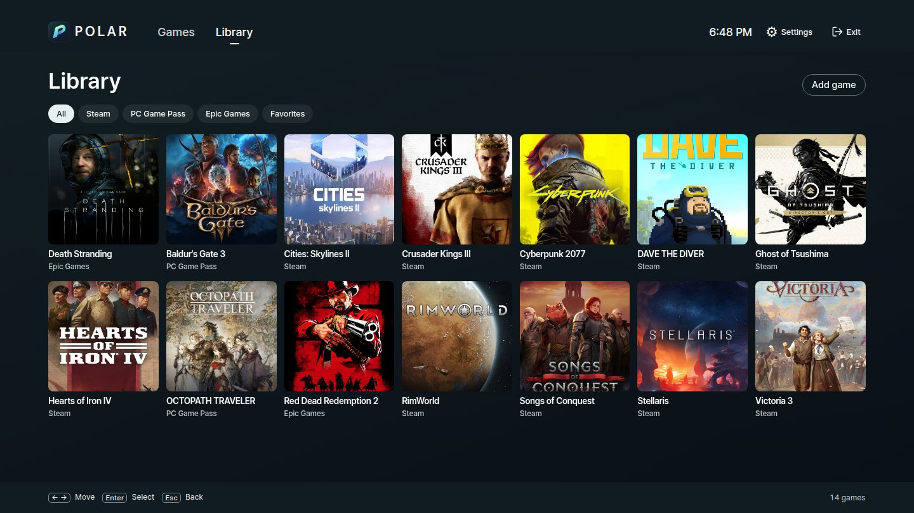

# Polar

A desktop launcher for the games you already have installed. Browse Steam, Epic Games, and PC Game Pass on one screen, then press **Play** to start a game through its original launcher. Polar is built with Rust and Tauri and supports English and Korean.


## Download

| Operating system | Installer | Supported libraries |
| --- | --- | --- |
| Windows 11 · x64 | [Download for Windows](https://github.com/Wondermove-Inc/polar/releases/download/v1.0.0-rc.22/Polar-1.0.0-rc.22-windows-x64-setup.exe) | Steam, Epic Games Launcher, PC Game Pass |
| Ubuntu 24.04 · x64 | [Download the .deb](https://github.com/Wondermove-Inc/polar/releases/download/v1.0.0-rc.22/Polar-1.0.0-rc.22-linux-x64.deb) | Steam, Epic games installed through Heroic |
| macOS 13+ · Apple Silicon | [Download for Apple Silicon](https://github.com/Wondermove-Inc/polar/releases/download/v1.0.0-rc.22/Polar-1.0.0-rc.22-macos-arm64.dmg) | Steam, Epic Games Launcher |

On **Windows**, quit Polar and run the installer to install or update it. On **Ubuntu**, run `sudo apt install ./Polar-1.0.0-rc.22-linux-x64.deb` from the download directory. On **Mac**, open the disk image and drag Polar into **Applications**.

RC22 is a release candidate. The Windows installer is unsigned. The Mac app is ad-hoc signed and has not been notarized by Apple. [Release notes and SHA-256 checksums](https://github.com/Wondermove-Inc/polar/releases/tag/v1.0.0-rc.22)

## Your library

- **Play from the couch.** Navigate with a gamepad, keyboard, or mouse in fullscreen or windowed mode. When Polar can detect a running game, its status appears on the Play button.
- **Keep favorites up front.** Right-click a tile or open the **…** menu beside Play and choose **Add to favorites**. Favorites appear first on the home screen and in each library filter.
- **Make the artwork yours.** Edit a game’s name, cover, or background. Keep local artwork available offline, or enable online images for high-resolution backgrounds.
- **Stay where you are.** Open the settings panel to change language, fullscreen, or reduced motion, then close it to return to the selected game.



These screenshots show Polar with a sample library. Games and artwork belong to their respective owners.

## Development

Install Rust and the native build dependencies for your operating system, then run the desktop app from the repository root. [Tauri prerequisites](https://v2.tauri.app/start/prerequisites/)

```sh
cargo run --locked -p polar-desktop
```

See the [user guide](docs/README.md) for setup and controls, and the [release workflow](.github/workflows/release.yml) for native builds and installer tests. This repository is public. Collaborators with write access can open pull requests, and repository administrators can merge to `main`.

## License and attribution

Wondermove owns the copyright in Polar’s original code and documentation and retains the right to license them.

You may fork this repository. Every fork, even one published under a new name, must include this credit and link to the original repository in its README.

> Based on [Polar by Wondermove](https://github.com/Wondermove-Inc/polar). Copyright © 2026 Wondermove.

Third-party dependencies, fonts, and game artwork remain subject to their respective licenses and copyright notices. [Bundled font notices](docs/FONT-LICENSES.txt)
