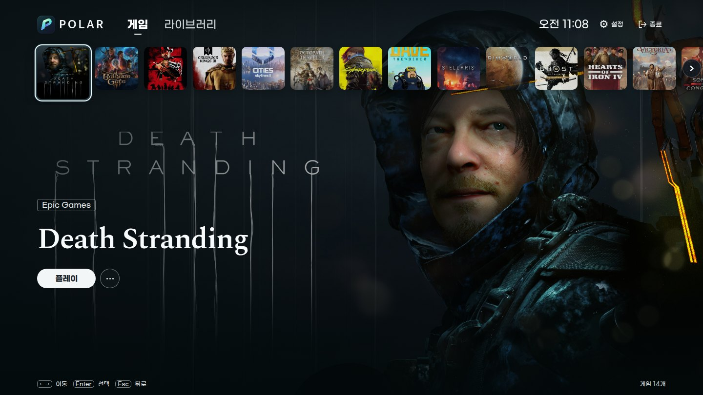

# Polar

Steam, Epic Games, PC Game Pass로 설치한 게임을 한 화면에서 고르고 실행하는 Rust 데스크톱 런처입니다. 소파에서는 게임패드로, 책상에서는 키보드와 마우스로 같은 라이브러리를 탐색할 수 있습니다.



## 다운로드

| 운영체제 | 설치 파일 | 게임 라이브러리 |
| --- | --- | --- |
| Windows 11 · x64 | [Windows 설치 프로그램](https://github.com/Wondermove-Inc/polar/releases/download/v1.0.0-rc.19/Polar-1.0.0-rc.19-windows-x64-setup.exe) | Steam · Epic Games · PC Game Pass |
| Ubuntu 24.04 · x64 | [Debian 패키지](https://github.com/Wondermove-Inc/polar/releases/download/v1.0.0-rc.19/Polar-1.0.0-rc.19-linux-x64.deb) | Steam · Heroic에 설치한 Epic 게임 |
| macOS 13 이상 · Apple Silicon | [Mac 디스크 이미지](https://github.com/Wondermove-Inc/polar/releases/download/v1.0.0-rc.19/Polar-1.0.0-rc.19-macos-arm64.dmg) | Steam · Epic Games Launcher |
| macOS 13 이상 · Intel | [Mac 디스크 이미지](https://github.com/Wondermove-Inc/polar/releases/download/v1.0.0-rc.19/Polar-1.0.0-rc.19-macos-x64.dmg) | Steam · Epic Games Launcher |

Windows에서는 Polar를 종료한 뒤 설치 파일을 실행합니다. 기존 설치도 같은 방법으로 업데이트할 수 있습니다. Ubuntu에서는 다운로드한 폴더에서 `sudo apt install ./Polar-1.0.0-rc.19-linux-x64.deb`를 실행합니다. Mac에서는 디스크 이미지를 열어 **Polar**를 **응용 프로그램**에 끌어 놓습니다.

RC19는 출시 후보입니다. Windows 설치 파일에는 게시자 서명이 없으며 macOS 앱은 Apple 공증을 받지 않았습니다. 운영체제에서 첫 실행 시 확인을 요청할 수 있습니다. [릴리즈 노트와 SHA-256 체크섬](https://github.com/Wondermove-Inc/polar/releases/tag/v1.0.0-rc.19)

## 라이브러리에서 할 수 있는 일

- **원래 런처로 바로 실행** · 타일을 골라 **플레이**를 누르면 해당 플랫폼이 게임을 엽니다. 실행 상태는 홈의 플레이 버튼에서 확인할 수 있습니다.
- **즐겨찾기 먼저 보기** · 타일을 우클릭하거나 플레이 옆 **…**에서 즐겨찾기에 추가하면 홈과 라이브러리 앞쪽에 표시됩니다.
- **내 게임에 맞게 꾸미기** · 게임별 이름, 표지, 배경을 바꿀 수 있습니다. 온라인 이미지는 설정에서 끌 수 있습니다.
- **거실과 데스크톱 모두 지원** · 전체 화면과 창 모드, 한국어와 영어, 모션 감소를 지원합니다. 오른쪽 설정 패널을 닫으면 보던 게임으로 돌아갑니다.


화면은 예시 라이브러리를 넣어 Polar에서 캡처했습니다. 게임 및 게임 이미지의 권리는 각 권리자에게 있습니다.

## 개발

Rust와 Tauri 2를 사용합니다. 플랫폼별 Tauri 빌드 도구를 설치한 뒤 아래 명령으로 데스크톱 앱을 열 수 있습니다. [Tauri 개발 환경](https://v2.tauri.app/start/prerequisites/)

```sh
cargo run --locked -p polar-desktop
```

자세한 조작 방법은 [사용 안내](docs/README.md)에, 설치 파일을 빌드하고 여는 검증 절차는 [릴리즈 워크플로](.github/workflows/release.yml)에 있습니다. 저장소는 공개이며 변경 제안용 PR은 쓰기 권한이 있는 협업자가 열 수 있습니다.
